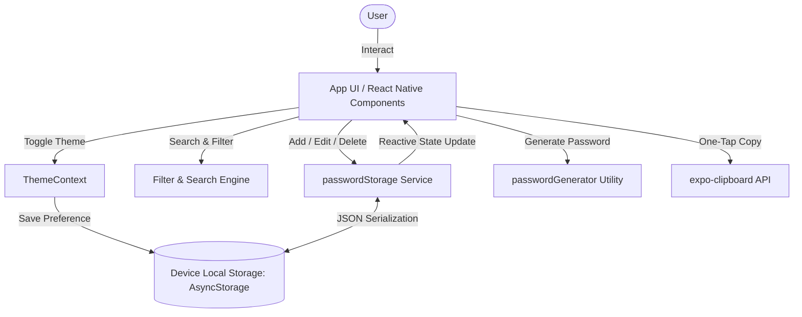
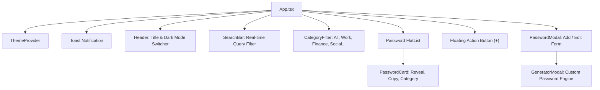

# 🔐 PassLock — Offline Expo Password Manager

A minimalist, high-performance, and privacy-focused password manager built with **React Native** and **Expo**.

- **No Remote Database**: 100% offline and local-first data storage.
- **No Login / Account Required**: Instant frictionless access directly to your passwords.
- **Dark & Light Mode**: Seamless theme switching with manual toggle and system appearance detection.
- **Simple, Modern UI**: Designed with clean typography, card layouts, category filters, and intuitive controls.
- **Built-in Password Generator**: Customizable length, character pools, and real-time password strength indicator.
- **One-Tap Copy & Feedback**: Instant clipboard copying with smooth visual feedback toasts.

---

## 📑 Table of Contents

1. [Architecture & Data Flow](#-architecture--data-flow)
2. [Features Breakdown](#-features-breakdown)
3. [File Tree](#-file-tree)
4. [Getting Started & Installation](#-getting-started--installation)
5. [Security Best Practices](#-security--privacy-notes)
6. [Running & Building the App](#-running--building-the-app)

---

## 🏗 Architecture & Data Flow

PassLock operates completely on-device without any cloud dependencies or analytics tracking.



### Component Structure



---

## ✨ Features Breakdown

| Feature | Description |
| :--- | :--- |
| **Local-First Storage** | Stores credentials locally on the device using `@react-native-async-storage/async-storage`. No remote servers, no cloud leakage. |
| **No Login Friction** | Direct entry to credentials without login screens, internet checks, or master passwords. |
| **Dual Theme System** | Full Dark Mode and Light Mode support. Persists your theme preference across app relaunches and syncs with OS theme changes. |
| **Masked Security** | Passwords are hidden by default (`••••••••••••`) with one-tap show/hide toggle. |
| **1-Click Copy** | One-tap button copies password directly into the system clipboard with an animated checkmark and floating confirmation toast. |
| **Custom Generator** | Create strong random passwords with custom lengths (8–32) and character sets (A-Z, a-z, 0-9, symbols). |
| **Strength Analyzer** | Evaluates password complexity in real-time (Weak, Fair, Good, Strong) with color-coded meters. |
| **Categorization & Search** | Instant filter by category tags (Work, Personal, Finance, Social, General) or full-text query. |

---

## 📁 File Tree

```text
passwordManager/
├── App.tsx                          # Root application & state coordination
├── app.json                         # Expo configuration
├── package.json                     # Dependencies and scripts
├── tsconfig.json                    # TypeScript compiler configuration
├── README.md                        # Documentation & setup guide
└── src/
    ├── types/
    │   └── index.ts                 # TypeScript models (PasswordItem, Theme, Category)
    ├── theme/
    │   ├── colors.ts                # Light & Dark color definitions
    │   └── ThemeContext.tsx         # Theme provider & hook (useAppTheme)
    ├── storage/
    │   └── passwordStorage.ts       # Local storage CRUD operations
    ├── utils/
    │   └── passwordGenerator.ts     # Password generation & strength evaluator
    └── components/
        ├── Header.tsx               # App bar with counter & theme toggle button
        ├── SearchBar.tsx            # Clean search input with quick clear
        ├── CategoryFilter.tsx       # Horizontal scrolling category filter pills
        ├── PasswordCard.tsx         # Password list card with show/hide and copy
        ├── PasswordModal.tsx        # Add/Edit bottom sheet modal
        ├── GeneratorModal.tsx       # Interactive password generator dialog
        └── Toast.tsx                # Floating notification banner
```

---

## 🚀 Getting Started & Installation

### 1. Prerequisites
- **Node.js** (v18.0.0 or higher recommended)
- **npm** or **yarn** / **pnpm**
- **Expo Go** app on your physical iOS or Android phone (or an emulator/simulator)

### 2. Install Dependencies
Run the following command inside the project directory:

```bash
npm install
```

Installed packages:
- `expo`: React Native core framework.
- `@react-native-async-storage/async-storage`: Safe, local on-device key-value persistence.
- `expo-clipboard`: Native clipboard integration.
- `expo-status-bar`: Dynamic status bar style matching Dark / Light mode.
- `@expo/vector-icons`: Pre-bundled Ionicons.

---

## 🔒 Security & Privacy Notes

1. **Zero Network Transmission**:
   - The application does not communicate with external servers or databases.
   - Credentials never leave your physical device.

2. **Device Sandboxing**:
   - Android and iOS isolate `AsyncStorage` inside the app's private sandboxed directory. Other apps cannot read this data unless the device is rooted/jailbroken.

3. **Optional Hardening (Keychain / Hardware Keystore)**:
   - For additional hardware-backed encryption, you can integrate `expo-secure-store` or AES-256 encryption (`crypto-js`) using a local device salt if you ever require hardware-level key wrapping.

---

## 📲 Running & Building the App

### Start Development Server
```bash
npx expo start
```

### Run on Platforms
- **Android**: Press <kbd>a</kbd> in the terminal or scan QR with Expo Go.
- **iOS**: Press <kbd>i</kbd> in the terminal or scan QR with Camera app.
- **Web**: Press <kbd>w</kbd> in the terminal to view in your web browser.

### Creating Production Builds (APK / IPA)
Using Expo Application Services (EAS):

```bash
# Install EAS CLI
npm install -g eas-cli

# Login and build standalone Android APK
eas build -p android --profile preview
```

---

## 💡 Summary

PassLock gives you an uncluttered, responsive, and completely private password management experience with zero account sign-up and zero database configuration required.
